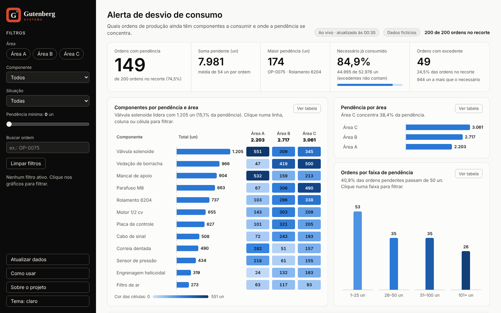

# Alerta de desvio de consumo

Fluxo ponta a ponta que detecta ordens de produção com consumo abaixo do necessário e avisa por e-mail: uma base no Google Sheets, um cálculo de pendências feito por **n8n ou Make**, uma notificação feita pelo **Zapier** e um **dashboard em HTML** com link público.

**Todos os dados são fictícios** (empresa Gutenberg Systems, Áreas A, B e C). O único destinatário de e-mail é um endereço de teste. O projeto não usa LLM nem chamadas de modelo.

- **Demo do dashboard (sem instalação):** https://prodigyb0y.github.io/alerta-desvio-consumo/



## Por que isso existe

Em operações industriais, cada ordem de produção deveria consumir os componentes previstos. Na prática, nem sempre isso acontece: a produção é apontada, mas o consumo não é baixado automaticamente no sistema, por falta de saldo em estoque ou por problemas operacionais. Essas pendências afetam a logística, o custo do estoque e a visão real do que está em andamento na fábrica.

O problema não é só a pendência, é a demora para enxergá-la. Separar as ordens que precisam de ação exige montar um recorte à mão, a partir de um relatório grande, com muita informação além das ordens, e repetir isso para cada área. Quem precisa agir, como programação e planejamento, recebe o sinal tarde, quando a pendência já se acumulou.

Este projeto recria essa rotina com dados fictícios. Ele calcula as pendências sozinho, avisa as equipes com o total e os componentes que mais pesam, e disponibiliza um dashboard para ver tudo em detalhe, para que a atenção vá primeiro para as ordens mais problemáticas. No modelo de produção, o aviso sai duas vezes por dia útil; na demo, o disparo é manual.

*Recriação conceitual de uma experiência real. Nenhum dado, nome de sistema ou informação da empresa de origem aparece aqui.*

## Tecnologias

| Camada | Tecnologia | Papel |
|---|---|---|
| Base de dados | Google Sheets | Abas `ordens` (200 linhas) e `resumo` (uma linha por execução) |
| Geração de dados | Python 3 (biblioteca padrão) | `gerar_dados.py` (seed 42), cálculo de referência e build do dashboard |
| Automação (cálculo) | n8n Cloud | Lê `ordens`, filtra, agrega e grava em `resumo` |
| Automação (cálculo) | Make | Mesmo cálculo, como alternativa ao n8n |
| Notificação | Zapier + Gmail | Zap de duas etapas: nova linha em `resumo` → e-mail HTML |
| Dashboard | HTML, CSS e JavaScript puros | Página única, publicada no GitHub Pages |
| Hospedagem e versionamento | GitHub e GitHub Pages | Repositório público e demo acessível por link |

## Como funciona

```
dados/ordens.csv ──► Google Sheets, aba "ordens"  (coluna H = D − E)
                              │
                ┌─────────────┴─────────────┐
                ▼                           ▼
        n8n (manual)                  Make (manual)        nunca os dois ativos
                └─────────────┬─────────────┘
                              ▼
              Google Sheets, aba "resumo"  (1 linha por execução)
                              │  nova linha
                              ▼
                  Zapier (2 etapas, sempre ligado)
                  Sheets "New Spreadsheet Row" ──► Gmail "Send Email"
                              │
                              ▼
                     e-mail HTML [N8N] ou [MAKE]

Dashboard HTML (GitHub Pages) ◄── lê a aba "ordens" publicada como CSV
```

1. **Base:** 200 ordens com `ordem, area, componente, qtd_necessaria, qtd_consumida, qtd_pendente, email_responsavel`. Na planilha, a coluna H `qtd_pendente_calc` é `qtd_necessaria − qtd_consumida`. Pendente é quando o valor é maior que zero.
2. **Cálculo:** n8n **ou** Make leem `ordens`, filtram `H > 0` e gravam uma linha em `resumo` com `data_execucao, ferramenta, total_pendentes, soma_pendente, top5_componentes, link_dashboard`. O gatilho é manual, por ser uma demonstração.
3. **Notificação:** o Zapier detecta a linha nova e envia o e-mail. Ele não agrega, não filtra e não calcula nada: só repassa os campos da linha. O assunto leva o prefixo da ferramenta que calculou (`[N8N]` ou `[MAKE]`).
4. **Dashboard:** barra lateral com a marca e os filtros, cinco indicadores (incluindo "Necessário já consumido", que não deixa o consumo a mais de uma ordem esconder a pendência de outra), matriz componente × área (barra de total e mapa de calor com todos os números), pendência por área, faixas de pendência e tabela de ordens, com filtros cruzados, tema claro e escuro, visão em tabela de cada gráfico e indicação de quando os dados vieram do Google Sheets ao vivo ou do snapshot. Só para computador (tela a partir de 1280 px).

## Resultado de referência

Cálculo independente em Python (`python3 scripts/calculo_referencia.py`), igual ao que n8n, Make, e-mail e dashboard mostram:

| Indicador | Valor |
|---|---|
| Ordens com pendência (> 0) | 149 de 200 |
| Soma da pendência | 7.981 un. |
| Top 5 | Válvula solenoide 1205 · Vedação de borracha 966 · Mancal de apoio 904 · Parafuso M8 863 · Rolamento 6204 737 |

E-mail recebido numa execução real (n8n):


## Resultados medidos

| Medida | Resultado | Como foi medida |
|---|---|---|
| Acerto das linhas gravadas em `resumo` | 4 de 4 linhas atuais iguais à referência (149 pendentes, 7.981 un., mesmo top 5): 3 do n8n e 1 do Make | Comparação linha a linha com `scripts/calculo_referencia.py` |
| E-mails disparados pelas linhas atuais | 3 de 4. A linha de 21:33 não disparou (ver Limitações) | Conferência da caixa de teste contra a aba `resumo` |
| Atraso entre a linha gravada e o e-mail | 2 medições: cerca de 2 min 04 s e 2 min 21 s, no plano de teste do Zapier (no gratuito, o gatilho pode levar até 15 min) | Horário gravado na linha de `resumo` vs. horário da execução no histórico do Zapier |
| Execuções do cenário Make | 7 no histórico: 6 com sucesso e 1 com erro, já corrigido (chave `{empty}` no mapeamento do top 5) | Histórico de execuções do Make |
| Duração de cada execução do Make | 0,4 s a 1,1 s | Duração registrada no histórico do Make |
| Tempo do processo manual | 5 min com experiência e 10 min sem experiência específica, por execução. Ganho de 4 e 9 min por execução, com leitura de 1 min do e-mail | Cronometragem do autor, 7 repetições em 18/11/2026, com a base fictícia |

### Ganho de tempo (processo manual cronometrado pelo autor)

**Premissas:** 2 execuções por dia útil, com 22 dias úteis por mês, 260 por ano e 5 por semana. O processo manual foi cronometrado pelo autor, em 7 repetições no dia 18/11/2026, com a base fictícia do projeto: 5 minutos para um profissional com experiência e 10 minutos para quem não tem essa experiência. O processo manual inclui pegar o arquivo, filtrar as ordens com consumo pendente, filtrar por área, exportar e, às vezes, montar um mini gráfico. Com o e-mail automático, a leitura leva 1 minuto por execução.

**Método:** horas ganhas = (minutos do processo manual − 1 minuto de leitura) × execuções no período ÷ 60.

| Período | Execuções | Profissional com experiência (4 min ganhos por execução) | Sem experiência (9 min ganhos por execução) |
|---|---|---|---|
| Semana | 10 | 40 min (0,7 h) | 90 min (1,5 h) |
| Mês | 44 | 176 min (2,9 h) | 396 min (6,6 h) |
| Ano | 520 | 2.080 min (34,7 h) | 4.680 min (78 h) |

Além das horas, o dashboard facilita a visualização das ordens e dos componentes com pendência. Esse ganho é qualitativo e não foi medido em tempo.

Detalhes da cronometragem e pendências em [`docs/resultados.md`](docs/resultados.md).

**Por que isso importa para um time de negócio:** em vez de montar o recorte à mão, quem acompanha os desvios recebe, a cada execução, o total de ordens com consumo abaixo do necessário, o volume pendente e os componentes que mais pesam, com link para o dashboard.

## Estrutura do repositório

| Caminho | Conteúdo |
|---|---|
| `dados/` | `ordens.csv`, a base fictícia |
| `scripts/` | Geração dos dados, cálculo de referência e build do dashboard |
| `dashboard/` | `template.html` (modelo do dashboard, só para computador) e `assets/` (logo e ícone da marca) |
| `n8n/` | `workflow.json`, o fluxo exportado |
| `make/` | Blueprint do cenário Make e como importar |
| `zapier/` | Descrição do Zap (etapas, campos, assunto e corpo) |
| `docs/` | Dashboard publicado, [evidências](docs/evidencias.md), [decisões](docs/decisoes.md), [planos](docs/planos.md) e imagens |

## Como reproduzir

1. `python3 scripts/gerar_dados.py` gera `dados/ordens.csv`.
2. Importe o CSV na aba `ordens` de uma planilha do Google, crie a aba `resumo` com os seis cabeçalhos e a coluna H com a fórmula `=D2-E2`.
3. **n8n:** importe `n8n/workflow.json` e refaça a credencial do Google Sheets. **Make:** siga [`make/README.md`](make/README.md). Use só um dos dois por rodada.
4. **Zapier:** crie o Zap descrito em [`zapier/README.md`](zapier/README.md), com o seu endereço de teste.
5. **Dashboard:** publique a aba `ordens` como CSV na web, ajuste `SHEET_CSV_URL` em `dashboard/template.html`, rode `python3 scripts/build_dashboard.py` e ative o GitHub Pages na pasta `docs/`.

## Limitações

- **Planos gratuitos:** Make com 1.000 créditos/mês; Zapier desenhado para 100 tarefas/mês e Zaps de duas etapas (o gatilho pode levar até 15 min); n8n Cloud em teste de 14 dias, por isso o fluxo está exportado em `n8n/workflow.json`. Comparação das ferramentas em [`docs/comparacao.md`](docs/comparacao.md). Detalhes em [`docs/planos.md`](docs/planos.md).
- **Gatilho manual:** não há agendamento. Em produção, bastaria um agendamento diário.
- **Aba `resumo`:** ao apagar linhas dela, desligue e ligue o Zap, senão a próxima linha nova pode não disparar o e-mail (ver [`zapier/README.md`](zapier/README.md)).
- **Amostra pequena:** 4 linhas em `resumo` e 2 medições de atraso. Os números acima servem para validar o fluxo, não para estimar desempenho.
- **Dados públicos:** a aba `ordens` é publicada como CSV para o dashboard ler. É seguro porque os dados são fictícios.
- **Só para computador:** o dashboard foi desenhado para telas a partir de 1280 px. Não há versão para tablet ou celular.
- **Acessibilidade:** contraste, teclado e árvore de acessibilidade foram verificados, mas o dashboard não foi testado com leitor de tela real (ver [`docs/evidencias.md`](docs/evidencias.md), fase 7).

Decisões de projeto (por que HTML no lugar do Looker Studio, gatilho manual, prefixo do assunto e o redesenho do dashboard) em [`docs/decisoes.md`](docs/decisoes.md).
